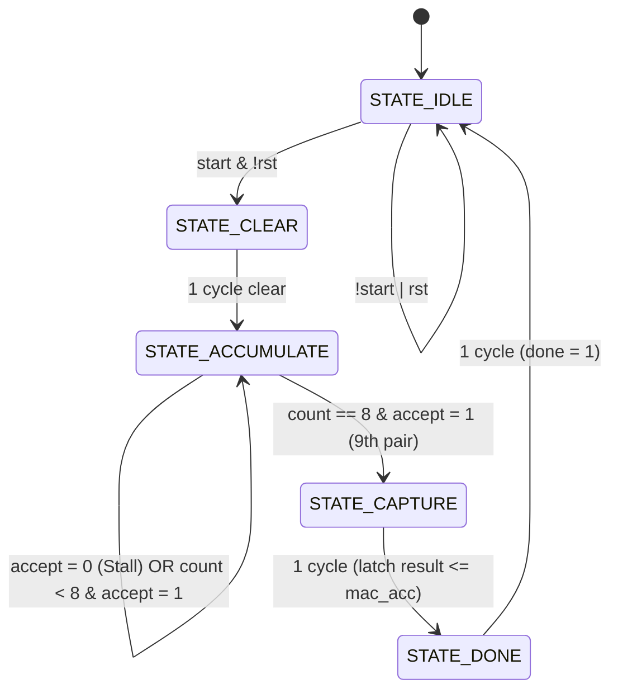

# ĐẶC TẢ KỸ THUẬT GIAI ĐOẠN 2: FSM & BỘ ĐẾM ĐIỀU KHIỂN TÍNH 9 CẶP INT8 (`dot9_int8`)

Tài liệu này mô tả chi tiết kiến trúc phần cứng, máy trạng thái hữu hạn (FSM), cơ chế bắt tay `valid`–`ready`, bộ đếm chu kỳ và phương pháp tránh tranh chấp Nonblocking Assignment (NBA) cho khối tính toán 9 tích số nguyên signed INT8: `dot9_int8`.

---

## 1. Tổng Quan và Mục Tiêu Thiết Kế

Khối `dot9_int8` đóng vai trò là lõi tính toán tích chập cơ bản (1 cửa sổ kernel $3 \times 3$) của bộ tăng tốc phần cứng. Module này bọc quanh khối `mac_int8` (đã hoàn thiện ở Giai đoạn 1), bổ sung khối điều khiển FSM và giao tiếp bắt tay tiêu chuẩn:

$$\text{result} = \sum_{k=0}^{8} X[k] \cdot W[k]$$

Trong đó:
- $X[k]$: Dữ liệu pixel hoặc activation (signed INT8, $[-128, +127]$).
- $W[k]$: Trọng số kernel (signed INT8, $[-128, +127]$).
- $\text{result}$: Kết quả tích lũy 32-bit (signed INT32).

---

## 2. Giao Tiếp Tín Hiệu (Interface Specification)

```
                       +-----------------------------+
                       |          dot9_int8          |
        clk ---------->|                             |
        rst ---------->|                             |
        start -------->|   +---------------------+   |---> busy
      in_valid ------->|   |     Control FSM     |   |---> done
                       |   |     & Counter       |   |
                       |   +----------+----------+   |
      in_ready <-------|              |              |
                       |              v              |
        x[7:0] ------->|   +---------------------+   |
        w[7:0] ------->|   |      mac_int8       |   |---> result[31:0]
                       |   +---------------------+   |
                       +-----------------------------+
```

### Bảng Tín Hiệu Module `dot9_int8`

| Tín hiệu | Hướng | Độ rộng | Kiểu dữ liệu | Mô tả chức năng |
|---|---|---|---|---|
| `clk` | Input | 1 bit | `logic` | Xung đồng hồ hệ thống (cạnh lên kích hoạt). |
| `rst` | Input | 1 bit | `logic` | Reset đồng bộ, mức tích cực cao (active-high). Ưu tiên cao nhất. |
| `start` | Input | 1 bit | `logic` | Xung kích hoạt 1 chu kỳ do bên ngoài cấp khi `busy = 0`. |
| `in_valid` | Input | 1 bit | `logic` | Nguồn dữ liệu báo toán hạng đầu vào `(x, w)` hợp lệ. |
| `in_ready` | Output | 1 bit | `logic` | Bộ tăng tốc báo sẵn sàng nhận toán hạng (chỉ tích cực trong `ACCUMULATE`). |
| `x` | Input | 8 bit | `logic signed [7:0]` | Toán hạng thứ nhất (Pixel / Activation). |
| `w` | Input | 8 bit | `logic signed [7:0]` | Toán hạng thứ hai (Weight / Kernel). |
| `busy` | Output | 1 bit | `logic` | Báo accelerator đang bận thực hiện tác vụ (mức cao ở mọi trạng thái trừ `IDLE`). |
| `done` | Output | 1 bit | `logic` | Xung báo hoàn tất đúng 1 chu kỳ xung clock. |
| `result` | Output | 32 bit | `logic signed [31:0]` | Tổng tích lũy 9 cặp, hợp lệ trong suốt chu kỳ `done=1` và giữ nguyên đến tác vụ sau hoặc reset. |

---

## 3. Kiến Trúc Máy Trạng Thái Hữu Hạn (FSM)

FSM điều khiển luồng tính toán qua 5 trạng thái tuần tự và đơn định:



### Chi Tiết Từng Trạng Thái:

1. **`STATE_IDLE` (`3'd0`)**:
   - `busy = 0`, `in_ready = 0`, `done = 0`.
   - `mac_clear = 0`, `mac_valid = 0`.
   - `result` giữ nguyên giá trị của tác vụ hoàn tất trước đó (hoặc `0` sau reset).
   - Chỉ chuyển sang `STATE_CLEAR` khi phát hiện `start = 1` tại cạnh lên `clk` và `rst = 0`.
   - Mọi dữ liệu tại `in_valid` trong `IDLE` đều bị từ chối (`in_ready = 0`).

2. **`STATE_CLEAR` (`3'd1`)**:
   - `busy = 1`, `in_ready = 0`, `done = 0`.
   - `mac_clear = 1`: Phát xung clear 1 chu kỳ tới module `mac_int8` để đặt lại thanh ghi tích lũy về `32'sd0`.
   - `count_q <= 4'd0`: Đặt lại bộ đếm số cặp về 0.
   - Sau đúng 1 chu kỳ, FSM tự động chuyển sang `STATE_ACCUMULATE`.

3. **`STATE_ACCUMULATE` (`3'd2`)**:
   - `busy = 1`, `done = 0`.
   - `in_ready = 1` (khi `rst = 0`): Cho phép nhận dữ liệu từ nguồn cấp.
   - Điều kiện bắt tay: `accept = in_valid && in_ready`.
   - Khi `accept = 1`:
     - `mac_valid = 1`: Cặp `(x, w)` được nạp vào `mac_int8`.
     - `count_q <= count_q + 1`.
     - **Điều kiện kết thúc nạp**: Khi đang ở cặp thứ 8 (`count_q == 4'd8`) và `accept = 1` (đây chính là cặp thứ 9!), FSM chuyển sang `STATE_CAPTURE`.
   - Khi `accept = 0` (nguồn tạm dừng đưa dữ liệu / stall):
     - `mac_valid = 0`: `mac_int8` giữ nguyên tổng tích lũy cũ.
     - `count_q` giữ nguyên giá trị.
     - FSM duy trì trạng thái `STATE_ACCUMULATE`, kiên nhẫn chờ dữ liệu hợp lệ mà không bao giờ báo `done` sớm.

4. **`STATE_CAPTURE` (`3'd3`)**:
   - `busy = 1`, `in_ready = 0`, `done = 0`.
   - `mac_clear = 0`, `mac_valid = 0`.
   - **Mục đích then chốt**: Ngay tại cạnh lên chuyển vào `CAPTURE`, cặp thứ 9 mới được `mac_int8` chốt vào tích lũy theo luật Nonblocking Assignment (`<=`). Do đó, trong suốt chu kỳ `CAPTURE`, `mac_acc` giữ giá trị tổng của đủ 9 tích một cách ổn định tuyệt đối.
   - Tại cạnh lên kết thúc `CAPTURE` (chuyển sang `DONE`):
     - Chốt kết quả: `result <= mac_acc;`.
     - Chuyển sang `STATE_DONE`.

5. **`STATE_DONE` (`3'd4`)**:
   - `busy = 1`, `in_ready = 0`.
   - `done = 1`: Xung báo hoàn tất mức cao kéo dài đúng 1 chu kỳ clock.
   - `result` chứa đầy đủ tổng tích lũy 9 cặp, hoàn toàn hợp lệ và ổn định trong suốt chu kỳ này.
   - Tại cạnh lên tiếp theo, FSM chuyển về `STATE_IDLE`, `done` tự động hạ về 0, `busy` hạ về 0, `result` vẫn giữ nguyên.

---

## 4. Phân Tích Kỹ Thuật Chống Tranh Chấp Nonblocking (NBA)

### Vấn đề: Tại sao không thể chốt `result` ngay tại cạnh nhận cặp thứ 9?

Trong SystemVerilog, khối tuần tự của `mac_int8` cập nhật thanh ghi bằng phép gán nonblocking (`<=`):
```systemverilog
always_ff @(posedge clk) begin
    ...
    else if (valid) begin
        acc <= acc + product_ext;
    end
end
```
Giả sử tại cạnh clock $E_9$, FSM nhận cặp thứ 9 (`accept = 1`).
- Trong vùng **Active Region** của cạnh $E_9$: Giá trị hiện tại của `acc` vẫn là tổng của **8 cặp trước đó**.
- Phép gán `acc <= acc + product_ext;` được lập lịch cập nhật vào vùng **NBA (Nonblocking Assignment Update Region)** sau đó.
- Nếu ở module cha `dot9_int8` ta gán `result <= mac_acc;` tại cùng cạnh $E_9$:
  Thanh ghi `result` sẽ lấy giá trị của `mac_acc` trước khi cập nhật (tức là chỉ có 8 cặp tích, **hoàn toàn mất trắng tích thứ 9**).

### Giải pháp phần cứng: Chu kỳ đệm `STATE_CAPTURE`
Bằng việc đưa FSM qua trạng thái `STATE_CAPTURE` trong 1 chu kỳ:
1. Cạnh $E_9$: Nhận cặp thứ 9, `mac_int8` cập nhật `acc` lên đủ 9 cặp tại vùng NBA của $E_9$.
2. Suốt chu kỳ `CAPTURE` (từ $E_9$ đến $E_{10}$): `mac_acc` đã ổn định hoàn toàn với tổng 9 cặp. `in_ready` đã hạ xuống 0 để chặn tuyệt đối cặp thứ 10.
3. Cạnh $E_{10}$: Chốt `result <= mac_acc;` và FSM chuyển sang `STATE_DONE`. Lúc này giá trị chốt được chắc chắn là tổng đầy đủ của cả 9 cặp, loại bỏ 100% nguy cơ tranh chấp mô phỏng và lỗi giữ dữ liệu vật lý.

---

## 5. Bảng Diễn Tiến Xung Clock Chuẩn

### Bảng 1: Chuỗi 9 cặp liên tục không có stall

| Cạnh clock | FSM State | start | in_valid | in_ready | accept | (x, w) | count | mac_acc | done | result | Ghi chú hành vi |
|:---:|:---:|:---:|:---:|:---:|:---:|:---:|:---:|:---:|:---:|:---:|:---|
| $E_0$ | `IDLE` | 1 | 0 | 0 | 0 | (0, 0) | 0 | 0 | 0 | 0 | Nhận xung `start` từ bên ngoài |
| $E_1$ | `CLEAR` | 0 | 0 | 0 | 0 | (0, 0) | 0 | 0 | 0 | 0 | Phát `mac_clear = 1`, xóa MAC |
| $E_2$ | `ACCUMULATE` | 0 | 1 | 1 | **1** | ($x_0, w_0$) | 0 | 0 | 0 | 0 | Nhận cặp 0; bắt đầu tích lũy |
| $E_3$ | `ACCUMULATE` | 0 | 1 | 1 | **1** | ($x_1, w_1$) | 1 | $P_0$ | 0 | 0 | Nhận cặp 1; MAC có tích 0 |
| $E_4$ | `ACCUMULATE` | 0 | 1 | 1 | **1** | ($x_2, w_2$) | 2 | $\sum_{0}^1 P$ | 0 | 0 | Nhận cặp 2 |
| $E_5$ | `ACCUMULATE` | 0 | 1 | 1 | **1** | ($x_3, w_3$) | 3 | $\sum_{0}^2 P$ | 0 | 0 | Nhận cặp 3 |
| $E_6$ | `ACCUMULATE` | 0 | 1 | 1 | **1** | ($x_4, w_4$) | 4 | $\sum_{0}^3 P$ | 0 | 0 | Nhận cặp 4 |
| $E_7$ | `ACCUMULATE` | 0 | 1 | 1 | **1** | ($x_5, w_5$) | 5 | $\sum_{0}^4 P$ | 0 | 0 | Nhận cặp 5 |
| $E_8$ | `ACCUMULATE` | 0 | 1 | 1 | **1** | ($x_6, w_6$) | 6 | $\sum_{0}^5 P$ | 0 | 0 | Nhận cặp 6 |
| $E_9$ | `ACCUMULATE` | 0 | 1 | 1 | **1** | ($x_7, w_7$) | 7 | $\sum_{0}^6 P$ | 0 | 0 | Nhận cặp 7 |
| $E_{10}$ | `ACCUMULATE` | 0 | 1 | 1 | **1** | ($x_8, w_8$) | 8 | $\sum_{0}^7 P$ | 0 | 0 | **Nhận cặp 8 (cặp thứ 9)** |
| $E_{11}$ | `CAPTURE` | 0 | 1 | **0** | **0** | ($x_9, w_9$) | 9 | $\sum_{0}^8 P$ | 0 | 0 | **Hạ in_ready = 0**; từ chối cặp 10 |
| $E_{12}$ | `DONE` | 0 | 0 | 0 | 0 | (0, 0) | 9 | $\sum_{0}^8 P$ | **1** | **$\sum_{0}^8 P$** | **done = 1**; result hợp lệ trọn vẹn |
| $E_{13}$ | `IDLE` | 0 | 0 | 0 | 0 | (0, 0) | 0 | $\sum_{0}^8 P$ | 0 | **$\sum_{0}^8 P$** | Về `IDLE`; result giữ nguyên |

---

### Bảng 2: Chuỗi có khoảng nghỉ valid (Stall Bubble) trước cặp thứ 9

Giả sử sau khi đã nhận 8 cặp đầu tiên, nguồn dữ liệu bị trễ mất 2 chu kỳ trước khi đưa cặp thứ 9:

| Cạnh clock | FSM State | in_valid | in_ready | accept | (x, w) | count | mac_acc | done | Ghi chú |
|:---:|:---:|:---:|:---:|:---:|:---:|:---:|:---:|:---:|:---|
| $E_{10}$ | `ACCUMULATE` | 0 | 1 | **0** | (N/A) | 8 | $\sum_0^7 P$ | 0 | **Stall chu kỳ 1**: `accept = 0`, tổng giữ nguyên |
| $E_{11}$ | `ACCUMULATE` | 0 | 1 | **0** | (N/A) | 8 | $\sum_0^7 P$ | 0 | **Stall chu kỳ 2**: `accept = 0`, không DONE sớm |
| $E_{12}$ | `ACCUMULATE` | 1 | 1 | **1** | ($x_8, w_8$) | 8 | $\sum_0^7 P$ | 0 | Cặp thứ 9 hợp lệ xuất hiện $\to$ chấp nhận |
| $E_{13}$ | `CAPTURE` | X | 0 | **0** | (X) | 9 | $\sum_0^8 P$ | 0 | Hạ `in_ready = 0`, chuẩn bị chốt |
| $E_{14}$ | `DONE` | 0 | 0 | **0** | (0) | 9 | $\sum_0^8 P$ | **1** | **done = 1** đúng thời điểm |

---

## 6. Cơ Chế Điều Khiển và Kháng Lỗi (Control & Robustness)

1. **Kháng xung START khi đang bận**:
   - Khi FSM đang ở các trạng thái `CLEAR`, `ACCUMULATE`, `CAPTURE` hoặc `DONE`, tín hiệu `busy = 1`.
   - Nếu có xung `start = 1` xuất hiện trong các trạng thái này, FSM hoàn toàn bỏ qua, không lưu hàng đợi và không làm gián đoạn tác vụ đang chạy.
2. **Cơ chế Reset đồng bộ tức thời**:
   - Khi `rst = 1` tại bất kỳ thời điểm nào:
     - FSM lập tức quay về `STATE_IDLE`.
     - `count_q <= 4'd0;` và `result <= 32'sd0;`.
     - Khối `mac_int8` cũng nhận `rst = 1` và xóa `acc <= 32'sd0;`.
     - Cờ `done = 0`, `busy = 0`, `in_ready = 0`.
     - Tuyệt đối không sinh xung `done` giả khi bị reset giữa chừng.
3. **Chống nhận trùng hoặc đếm thừa toán hạng**:
   - Bộ đếm và MAC chỉ tích lũy khi có điều kiện bắt tay đồng thời: `accept = in_valid && in_ready`.
   - Nếu nguồn giữ nguyên dữ liệu trong nhiều chu kỳ mà `in_ready = 0` (backpressure), dữ liệu chỉ được tiêu thụ đúng 1 lần khi `in_ready = 1`.
   - Sau khi nhận đủ 9 cặp, `in_ready` lập tức hạ về 0 tại cạnh chuyển trạng thái sang `CAPTURE`, bảo đảm cặp thứ 10 không bao giờ bị nhận vào tác vụ hiện tại.
