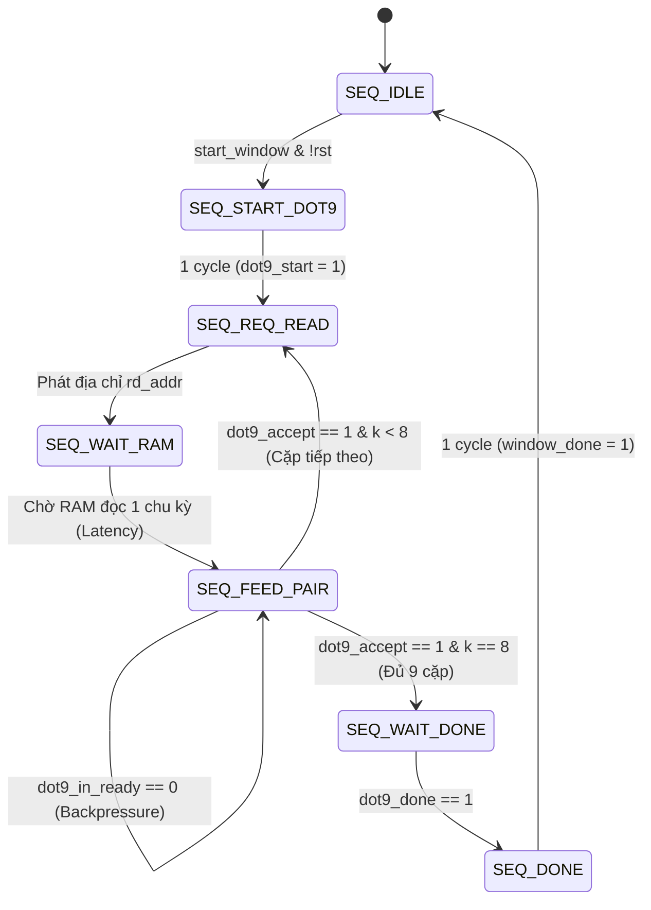

# ĐẶC TẢ KỸ THUẬT GIAI ĐOẠN 3: BỘ ĐỆM RAM ĐỒNG BỘ & TRÍCH XUẤT CỬA SỔ 3x3 (`conv_window_reader`)

Tài liệu này mô tả chi tiết kiến trúc phần cứng, mô hình bộ đệm RAM đọc đồng bộ có độ trễ 1 chu kỳ (Block RAM Inference), bộ sinh địa chỉ cửa sổ $3 \times 3$ và khối Sequencer điều khiển cấp dữ liệu cho `dot9_int8` thông qua giao thức bắt tay `valid`–`ready`.

---

## 1. Tổng Quan và Mục Tiêu Thiết Kế Giai Đoạn 3

Trong kiến trúc tăng tốc tích chập, trước khi tiến hành quét toàn bộ bức ảnh $32 \times 32$ (Giai đoạn 4), Giai đoạn 3 tập trung giải quyết bài toán: **Lưu trữ ma trận ảnh và trọng số trong bộ nhớ nội (On-chip RAM), sinh địa chỉ truy xuất một cửa sổ $3 \times 3$ bất kỳ và cấp dữ liệu tuần tự 9 cặp vào khối tính toán `dot9_int8` mà không làm sai lệch dữ liệu do độ trễ đọc của RAM**.

### Phạm vi và quy ước:
- **Input Buffer**: Lưu trữ toàn bộ bức ảnh $32 \times 32 = 1,024$ phần tử signed INT8 (1,024 bytes).
- **Weight Buffer**: Lưu trữ 9 trọng số signed INT8 của kernel $3 \times 3$.
- **Độ trễ đọc (Read Latency)**: Cả hai bộ đệm đều là RAM đọc đồng bộ với độ trễ đúng 1 chu kỳ clock (Synchronous Read, 1-cycle latency), cấu trúc chuẩn để trình tổng hợp Vivado suy diễn thành FPGA Block RAM (BRAM).
- **Không lật kernel**: Phép tính tích chập tuân thủ quy ước mạng nơ-ron CNN (Cross-Correlation), phần tử $W[k]$ nhân tương ứng với $X[k]$ ($k = 0..8$).
- **Không quét toàn bộ**: Giai đoạn 3 nhận tọa độ `(out_row, out_col)` và chỉ tính toán cho đúng 1 cửa sổ được chỉ định. Việc quét tự động $30 \times 30 = 900$ output thuộc về Giai đoạn 4.

---

## 2. Kiến Trúc Phần Cứng (Block Diagram)

```
================================ conv_window_reader ================================
                                                                                   
  ibuf_wr_en, addr, data ---> +--------------------+                               
                              |    Input Buffer    |                               
                              | (1024 x 8-bit RAM) | ---> ibuf_rd_data [7:0]       
                              +---------+----------+              |                
                                        ^                         |                
                                        | ibuf_rd_addr            |                
  wbuf_wr_en, addr, data ---> +---------+----------+              |                
                              |   Weight Buffer    |              |                
                              |  (9 x 8-bit RAM)   | ---> wbuf_rd_data [7:0]       
                              +---------+----------+              |                
                                        ^                         |                
                                        | wbuf_rd_addr            |                
                              +---------+----------+              |                
start_window -------------->  |                    |              v                
out_row[4:0], out_col[4:0] -> | Window Sequencer   | ---> +---------------+        
                              | & Addr Generator   |      |   dot9_int8   |        
busy <----------------------- |                    | <--- |  Accelerator  |        
window_done <---------------- |                    |      +-------+-------+        
                              +--------------------+              |                
                                                                  v                
                                                            window_result[31:0]    
====================================================================================
```

---

## 3. Giao Tiếp Tín Hiệu (Interface Specification)

### 3.1 Cổng giao tiếp module `conv_window_reader`

| Tín hiệu | Hướng | Độ rộng | Kiểu | Mô tả chức năng |
|---|---|---|---|---|
| `clk` | Input | 1 bit | `logic` | Xung clock hệ thống (100 MHz). |
| `rst` | Input | 1 bit | `logic` | Reset đồng bộ, mức tích cực cao (active-high). |
| **Cổng ghi Input Buffer** | | | | |
| `ibuf_wr_en` | Input | 1 bit | `logic` | Cho phép ghi dữ liệu ảnh vào Input Buffer. |
| `ibuf_wr_addr` | Input | 10 bit | `logic [9:0]` | Địa chỉ ghi ảnh ($0 \to 1023$). |
| `ibuf_wr_data` | Input | 8 bit | `logic signed [7:0]` | Giá trị pixel cần ghi (signed INT8). |
| **Cổng ghi Weight Buffer** | | | | |
| `wbuf_wr_en` | Input | 1 bit | `logic` | Cho phép ghi trọng số kernel. |
| `wbuf_wr_addr` | Input | 4 bit | `logic [3:0]` | Địa chỉ ghi trọng số ($0 \to 8$). |
| `wbuf_wr_data` | Input | 8 bit | `logic signed [7:0]` | Giá trị trọng số kernel (signed INT8). |
| **Giao tiếp Điều khiển** | | | | |
| `start_window` | Input | 1 bit | `logic` | Xung 1 chu kỳ kích hoạt đọc và tính toán cửa sổ tại `(out_row, out_col)`. |
| `out_row` | Input | 5 bit | `logic [4:0]` | Tọa độ hàng của pixel output ($0 \to 29$). |
| `out_col` | Input | 5 bit | `logic [4:0]` | Tọa độ cột của pixel output ($0 \to 29$). |
| **Đầu ra Trạng thái & Kết quả** | | | | |
| `busy` | Output | 1 bit | `logic` | Báo module đang bận xử lý cửa sổ (mức cao suốt quá trình tính). |
| `window_done` | Output | 1 bit | `logic` | Xung báo hoàn tất cửa sổ đúng 1 chu kỳ clock. |
| `window_result` | Output | 32 bit | `logic signed [31:0]` | Kết quả tổng tích chập 9 cặp của cửa sổ được chỉ định. |

---

## 4. Bộ Sinh Địa Chỉ Cửa Sổ (Window Address Generator)

Đối với ảnh kích thước $W = 32$, mỗi pixel tại tọa độ hàng $r$ và cột $c$ có địa chỉ tuyến tính:
$$\text{addr} = r \times 32 + c = (r \ll 5) \ | \ c$$

Với cửa sổ $3 \times 3$ có góc trên-trái tại `(out_row, out_col)`, 9 phần tử tương ứng với $k \in [0, 8]$ được trích xuất theo bảng:

| Chỉ số $k$ | Độ lệch hàng $dr$ | Độ lệch cột $dc$ | Tọa độ pixel trong ảnh $(r, c)$ | Trọng số kernel |
|:---:|:---:|:---:|:---|:---:|
| **0** | 0 | 0 | `(out_row + 0, out_col + 0)` | $W[0]$ |
| **1** | 0 | 1 | `(out_row + 0, out_col + 1)` | $W[1]$ |
| **2** | 0 | 2 | `(out_row + 0, out_col + 2)` | $W[2]$ |
| **3** | 1 | 0 | `(out_row + 1, out_col + 0)` | $W[3]$ |
| **4** | 1 | 1 | `(out_row + 1, out_col + 1)` | $W[4]$ |
| **5** | 1 | 2 | `(out_row + 1, out_col + 2)` | $W[5]$ |
| **6** | 2 | 0 | `(out_row + 2, out_col + 0)` | $W[6]$ |
| **7** | 2 | 1 | `(out_row + 2, out_col + 1)` | $W[7]$ |
| **8** | 2 | 2 | `(out_row + 2, out_col + 2)` | $W[8]$ |

Phần cứng tính toán địa chỉ bằng phép dịch bit tổ hợp, hoàn toàn không cần bộ nhân phần cứng:
```systemverilog
pix_r = {1'b0, r} + {4'd0, dr};
pix_c = {1'b0, c} + {4'd0, dc};
ibuf_rd_addr = (pix_r[4:0] << 5) | pix_c[4:0];
```

---

## 5. Máy Trạng Thái FSM Sequencer & Xử Lý Độ Trễ Đọc RAM

FSM Sequencer điều khiển luồng nạp dữ liệu tuần tự với nguyên tắc thiết kế tường minh, không để xảy ra lỗi tranh chấp hay đọc vượt:



### Xử lý độ trễ đọc 1 chu kỳ:
1. Tại chu kỳ `SEQ_REQ_READ`: Sequencer phát địa chỉ đọc `ibuf_rd_addr` và `wbuf_rd_addr`. Tại cạnh lên tiếp theo, RAM chốt địa chỉ vào thanh ghi nội bộ.
2. Tại chu kỳ `SEQ_WAIT_RAM`: RAM thực hiện truy xuất dữ liệu trong mảng nhớ. Tại cạnh lên tiếp theo, dữ liệu đọc xuất hiện tại đầu ra `rd_data`.
3. Tại chu kỳ `SEQ_FEED_PAIR`: Dữ liệu `ibuf_rd_data` và `wbuf_rd_data` đã hoàn toàn hợp lệ. Sequencer bật `dot9_in_valid = 1`.
   - **Xử lý Backpressure**: Nếu `dot9_in_ready == 0`, Sequencer giữ nguyên `dot9_in_valid = 1` cùng toán hạng `x, w` ổn định trên bus, tuyệt đối không nhảy trạng thái hay thay đổi địa chỉ đọc.
   - Khi `dot9_accept = 1`: Chuyển sang đọc cặp tiếp theo ($k+1$).
