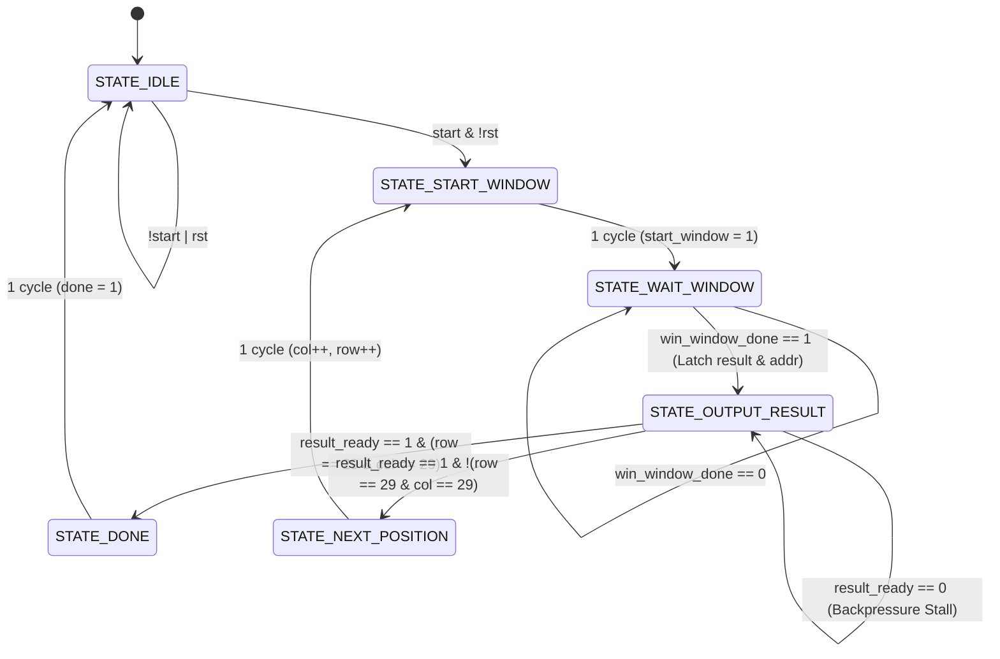

# ĐẶC TẢ KỸ THUẬT GIAI ĐOẠN 4: BỘ QUÉT RASTER VÀ TÍCH CHẬP 2D (`conv2d_raster_scanner`)

Tài liệu này mô tả chi tiết kiến trúc phần cứng, máy trạng thái hữu hạn (FSM), bộ sinh tọa độ Raster Scan, cơ chế bắt tay `result_valid`–`result_ready` chống backpressure, cùng quy trình kiểm chứng toàn diện cho bộ tăng tốc tích chập INT8 quét tự động ma trận ảnh $32 \times 32$.

---

## 1. Mục Tiêu Giai Đoạn 4

Ở Giai đoạn 3 (`conv_window_reader`), phần cứng đã trích xuất thành công một cửa sổ $3 \times 3$ tại một tọa độ `(out_row, out_col)` bất kỳ từ bộ đệm RAM đồng bộ và cấp vào lõi `dot9_int8` để tính một giá trị output 32-bit.

Mục tiêu cốt lõi của **Giai đoạn 4** là hiện thực module điều khiển quét tự động toàn bộ ma trận đặc trưng đầu vào (Input Feature Map):
1. **Tự động quét toàn bộ ảnh**: Quét tuần tự $30 \times 30 = 900$ cửa sổ $3 \times 3$ trên ma trận ảnh $32 \times 32$ theo đúng thứ tự Raster Scan (từ trái sang phải, từ trên xuống dưới).
2. **Tái sử dụng phần cứng tối đa (Hardware Reuse)**: Chỉ khởi tạo **DUY NHẤT một instance** `conv_window_reader` (bên trong chứa một bộ đệm ảnh BRAM, một bộ đệm trọng số LUTRAM, một lõi `dot9_int8`, một khối `mac_int8`, và một bộ nhân `int8_multiplier`). Tuyệt đối không nhân bản 900 bộ tính toán song song tốn tài nguyên.
3. **Giao tiếp đầu ra dạng Stream (Ready/Valid Handshake)**: Báo kết quả hợp lệ qua `result_valid`, hỗ trợ cơ chế phản hồi áp lực ngược (Backpressure) qua tín hiệu `result_ready` từ phía Consumer (Bộ đệm output / Bus AXI / CPU) mà không làm rơi hay xáo trộn kết quả.
4. **Không phát sinh lỗi Off-by-one hay sai lệch địa chỉ**: Sinh chính xác 900 địa chỉ tuyến tính $0 \to 899$ tương ứng từng pixel output `result_addr = out_row * 30 + out_col`.

---

## 2. Vai Trò Của `conv2d_raster_scanner`

Trong kiến trúc tổng thể SoC RISC-V:
- **`conv2d_raster_scanner`** đóng vai trò là **Master Sequencer cấp cao nhất** của Hardware Accelerator.
- Module nhận lệnh bắt đầu (`start`) từ CPU hoặc bộ điều khiển DMA, tự động điều phối chuỗi tính toán 900 cửa sổ liên tiếp, và thông báo hoàn tất qua cờ `done` 1 chu kỳ khi kết quả thứ 900 được truyền thành công.
- Module đóng vai trò cầu nối dữ liệu:
  - Cho phép nạp trước ma trận ảnh ($1,024$ bytes) và trọng số kernel ($9$ bytes) qua các cổng ghi bộ đệm `ibuf_wr_*` và `wbuf_wr_*`.
  - Cung cấp luồng dữ liệu kết quả tích chập 32-bit theo chuẩn streaming công nghiệp.

---

## 3. Sơ Đồ Kiến Trúc Kết Nối (Block Diagram)

```
=================================== conv2d_raster_scanner ===================================
                                                                                           
   ibuf_wr_en, addr, data ------------+                                                    
   wbuf_wr_en, addr, data -------+    |                                                    
                                 |    |                                                    
                                 v    v                                                    
                         +-----------------------------------+                             
                         |        conv_window_reader         |                             
                         |                                   |                             
                         |  +-----------------------------+  |                             
                         |  | Input Buffer (1024x8 BRAM)  |  |                             
                         |  +-----------------------------+  |                             
                         |  | Weight Buffer (9x8 LUTRAM)  |  |                             
                         |  +-----------------------------+  |                             
                         |  | Window Sequencer & Addr Gen |  |                             
                         |  +--------------+--------------+  |                             
                         |                 |                 |                             
                         |                 v                 |                             
                         |  +-----------------------------+  |                             
                         |  |          dot9_int8          |  |                             
                         |  |  +-----------------------+  |  |                             
                         |  |  |       mac_int8        |  |  |                             
                         |  |  |  +-----------------+  |  |  |                             
                         |  |  |  | int8_multiplier |  |  |  |                             
                         |  |  |  +-----------------+  |  |  |                             
                         |  |  +-----------------------+  |  |                             
                         |  +--------------+--------------+  |                             
                         |                 |                 |                             
                         +-----------------+-----------------+                             
                                  ^        |                                               
                    start_window  |        | window_done                                   
              out_row[4:0], col   |        | window_result [31:0]                          
                                  |        v                                               
    clk, rst, start ----------> +----------------------------+                             
                                | Raster Scanner Controller  |                             
    busy <--------------------- | - Row Counter (0..29)      | ---> result_valid           
    done <--------------------- | - Col Counter (0..29)      | <--- result_ready           
                                | - FSM Sequencer            | ---> result_data [31:0]     
                                | - Result Latch Registers   | ---> result_addr [9:0]      
                                +----------------------------+                             
=============================================================================================
```

---

## 4. Danh Sách Input/Output và Chức Năng

| Tín hiệu | Hướng | Độ rộng | Kiểu dữ liệu | Mô tả chức năng |
|---|---|---|---|---|
| **Điều khiển hệ thống** | | | | |
| `clk` | Input | 1 bit | `logic` | Xung clock hệ thống (100 MHz). |
| `rst` | Input | 1 bit | `logic` | Reset đồng bộ, mức tích cực cao (active-high). |
| `start` | Input | 1 bit | `logic` | Xung 1 chu kỳ kích hoạt bắt đầu quét toàn bộ ảnh (chỉ nhận khi `busy = 0`). |
| `busy` | Output | 1 bit | `logic` | Mức cao trong suốt thời gian quét và tính toán 900 cửa sổ. |
| `done` | Output | 1 bit | `logic` | Xung báo hoàn tất toàn bộ ảnh đúng 1 chu kỳ clock sau khi kết quả thứ 900 được nhận. |
| **Ghi nạp Input Buffer** | | | | |
| `ibuf_wr_en` | Input | 1 bit | `logic` | Cho phép ghi pixel vào Input Buffer. |
| `ibuf_wr_addr` | Input | 10 bit | `logic [9:0]` | Địa chỉ ghi ảnh ($0 \to 1023$). |
| `ibuf_wr_data` | Input | 8 bit | `logic signed [7:0]` | Giá trị pixel nạp vào bộ đệm (signed INT8). |
| **Ghi nạp Weight Buffer** | | | | |
| `wbuf_wr_en` | Input | 1 bit | `logic` | Cho phép ghi trọng số vào Weight Buffer. |
| `wbuf_wr_addr` | Input | 4 bit | `logic [3:0]` | Địa chỉ ghi kernel ($0 \to 8$). |
| `wbuf_wr_data` | Input | 8 bit | `logic signed [7:0]` | Giá trị trọng số nạp vào bộ đệm (signed INT8). |
| **Giao tiếp Output Stream** | | | | |
| `result_valid` | Output | 1 bit | `logic` | Báo kết quả tại `result_data` và `result_addr` hợp lệ. |
| `result_ready` | Input | 1 bit | `logic` | Phía nhận (Consumer) báo sẵn sàng nhận kết quả. |
| `result_data` | Output | 32 bit | `logic signed [31:0]` | Giá trị tích chập signed INT32 của cửa sổ hiện tại. |
| `result_addr` | Output | 10 bit | `logic [9:0]` | Địa chỉ tuyến tính $0 \to 899$ của pixel output. |

---

## 5. Giải Thích Máy Trạng Thái FSM

FSM của `conv2d_raster_scanner` được thiết kế theo mô hình Moore/Mealy kết hợp với các thanh ghi ngõ ra chốt đồng bộ (Registered Outputs) nhằm loại bỏ hoàn toàn hiện tượng glitch và giảm thiểu độ trễ tới bus bên ngoài.



### Chi tiết các trạng thái:

1. **`STATE_IDLE` (`3'd0`)**:
   - `busy = 0`, `done = 0`, `result_valid = 0`.
   - `cur_row <= 0`, `cur_col <= 0`.
   - Khi có xung `start = 1` và `rst = 0`: FSM chuyển sang `STATE_START_WINDOW`.
   - Nếu `start = 1` xuất hiện khi đang ở các trạng thái khác (`busy = 1`), xung sẽ bị bỏ qua an toàn.

2. **`STATE_START_WINDOW` (`3'd1`)**:
   - `busy = 1`, `win_start_window = 1`.
   - Cung cấp tọa độ `out_row = cur_row_q` và `out_col = cur_col_q` cho `conv_window_reader`.
   - Sau đúng 1 chu kỳ clock, FSM chuyển sang `STATE_WAIT_WINDOW`.

3. **`STATE_WAIT_WINDOW` (`3'd2`)**:
   - `busy = 1`, `win_start_window = 0`.
   - Chờ module `conv_window_reader` trích xuất 9 phần tử và tính tích lũy MAC (khoảng 30 chu kỳ).
   - Khi `win_window_done == 1`:
     - Chốt kết quả tính toán: `reg_result_data <= win_window_result;`
     - Chốt địa chỉ tuyến tính: `reg_result_addr <= (cur_row_q * 30) + cur_col_q;`
     - FSM chuyển sang `STATE_OUTPUT_RESULT`.

4. **`STATE_OUTPUT_RESULT` (`3'd3`)**:
   - `busy = 1`, `result_valid = 1`.
   - Dữ liệu `result_data` và `result_addr` được giữ ổn định 100% từ các thanh ghi chốt.
   - **Xử lý Backpressure**: Nếu `result_ready == 0`, FSM giữ nguyên trạng thái `STATE_OUTPUT_RESULT`, không cập nhật tọa độ, không mất dữ liệu.
   - Khi `result_ready == 1` (Bắt tay thành công):
     - Nếu đang ở cửa sổ cuối cùng `(29, 29)`: Chuyển sang `STATE_DONE`.
     - Ngược lại: Chuyển sang `STATE_NEXT_POSITION`.

5. **`STATE_NEXT_POSITION` (`3'd4`)**:
   - `busy = 1`, `result_valid = 0`.
   - Tăng tọa độ quét theo thứ tự Raster Scan:
     ```systemverilog
     if (cur_col_q == 29) begin
         cur_col <= 0;
         cur_row <= cur_row_q + 1;
     end else begin
         cur_col <= cur_col_q + 1;
     end
     ```
   - Chuyển sang `STATE_START_WINDOW` để kích hoạt cửa sổ tiếp theo.

6. **`STATE_DONE` (`3'd5`)**:
   - `busy = 1`, `result_valid = 0`, `done = 1`.
   - Báo hoàn tất toàn bộ bức ảnh $32 \times 32$ (đủ 900 kết quả).
   - Sau đúng 1 chu kỳ clock, FSM tự động trở về `STATE_IDLE`.

---

## 6. Cách Quét Ma Trận Output 30×30 (Raster Scan Order)

Với ảnh kích thước $W_{in} = 32, H_{in} = 32$, Kernel $K = 3$, Stride $S = 1$, Padding $P = 0$:
$$W_{out} = \frac{W_{in} - K + 2P}{S} + 1 = \frac{32 - 3 + 0}{1} + 1 = 30$$
$$H_{out} = \frac{H_{in} - K + 2P}{S} + 1 = \frac{32 - 3 + 0}{1} + 1 = 30$$
$$\text{Tổng số kết quả} = W_{out} \times H_{out} = 30 \times 30 = 900$$

### Thứ tự quét (Hàng trước, Cột sau):
```text
Hàng 0: (0,0)  -> addr 0     (0,1)  -> addr 1     ...  (0,29)  -> addr 29
Hàng 1: (1,0)  -> addr 30    (1,1)  -> addr 31    ...  (1,29)  -> addr 59
...
Hàng 29: (29,0) -> addr 870   (29,1) -> addr 871   ...  (29,29) -> addr 899
```

Công thức tính địa chỉ tuyến tính:
$$\text{result\_addr} = \text{cur\_row} \times 30 + \text{cur\_col}$$

Độ rộng thanh ghi địa chỉ:
$$N_{bits} = \lceil \log_2(900) \rceil = 10 \text{ bits } ([9:0] \text{ biểu diễn } 0 \to 1023)$$

---

## 7. Cơ Chế Bắt Tay Output (Ready/Valid Handshake)

Chuẩn giao tiếp streaming được thiết kế tuân thủ nghiêm ngặt các quy tắc:
1. **Chuyển giao dữ liệu (Transfer Beat)**: Xảy ra tại cạnh lên `posedge clk` khi và chỉ khi:
   $$\text{Transfer} \iff (\text{result\_valid} == 1) \land (\text{result\_ready} == 1)$$
2. **Kháng áp lực ngược (Backpressure Invariance)**:
   - Khi `result_valid = 1` mà `result_ready = 0`:
     - Phía phát (DUT) bắt buộc phải giữ nguyên `result_valid = 1`.
     - Giữ nguyên toàn bộ giá trị `result_data` và `result_addr`.
     - Tuyệt đối không nhảy sang cửa sổ tiếp theo hay ghi đè dữ liệu mới.
3. **Không tạo vòng lặp tổ hợp (No Combinational Loop)**:
   - `result_valid` được xuất ra từ trạng thái thanh ghi nội bộ FSM.
   - `result_data` và `result_addr` xuất ra từ thanh ghi flip-flop chốt trực tiếp.
   - Tín hiệu `result_ready` từ bên ngoài chỉ điều khiển chuyển trạng thái tiếp theo ở chu kỳ clock sau, hoàn toàn không nối ngược tổ hợp vào `result_valid`.

---

## 8. Ví Dụ Tính Một Cửa Sổ 3×3

Giả sử cửa sổ tại tọa độ `(0, 0)`:
- Góc trên-trái tại pixel `(0, 0)`.
- 9 pixel được trích xuất từ Input Buffer:
  $$\begin{bmatrix} X(0,0) & X(0,1) & X(0,2) \\ X(1,0) & X(1,1) & X(1,2) \\ X(2,0) & X(2,1) & X(2,2) \end{bmatrix}$$
- 9 trọng số từ Weight Buffer:
  $$\begin{bmatrix} W_0 & W_1 & W_2 \\ W_3 & W_4 & W_5 \\ W_6 & W_7 & W_8 \end{bmatrix}$$
- Kết quả tích chập (Cross-correlation, không lật kernel):
  $$Y(0,0) = \sum_{k=0}^{8} X_k \cdot W_k = (X_{0,0} \cdot W_0) + (X_{0,1} \cdot W_1) + \dots + (X_{2,2} \cdot W_8)$$
- Giá trị này được tích lũy bù hai trong bộ cộng 32-bit của `mac_int8`, xuất ra `result_data` kèm `result_addr = 0`.

---

## 9. Cách Tạo Ra 900 Kết Quả

1. **Khởi động**: Nạp trước ảnh $32 \times 32$ vào BRAM và kernel $3 \times 3$ vào LUTRAM khi accelerator ở trạng thái rỗi (`busy = 0`).
2. **Kích hoạt quét**: Cấp xung `start = 1` trong 1 chu kỳ clock.
3. **Vòng lặp tự động**:
   - FSM phát `start_window` với `(0, 0)`.
   - `conv_window_reader` đọc BRAM và tính trong ~30 chu kỳ.
   - Chốt kết quả, phát `result_valid = 1` tại `result_addr = 0`.
   - Chờ `result_ready = 1` để bàn giao.
   - Tăng cột: `(0, 1)`, lặp lại quy trình.
   - Khi hết cột 29: Chuyển sang hàng tiếp theo `(1, 0)`.
   - Lặp lại cho tới khi hoàn tất `(29, 29)`.
4. **Kết thúc**: Sau khi kết quả thứ 900 được Consumer tiếp nhận, FSM phát xung `done = 1` trong 1 chu kỳ clock và hạ `busy = 0`.

---

## 10. Phương Pháp Kiểm Chứng và Testbench

Testbench tự kiểm tra `tb/tb_conv2d_raster_scanner.sv` được xây dựng với mô hình tham chiếu độc lập (Golden Reference Model):
- Mô hình tham chiếu độc lập tính toán ma trận kết quả $30 \times 30$ lý tưởng từ dữ liệu đầu vào bằng phần mềm SystemVerilog thuần túy (không lấy từ DUT).
- 9 bài kiểm tra chuyên sâu bao phủ 100% không gian chức năng và tình huống biên:

| Bài test | Tên kiểm tra | Mô tả chi tiết |
|---|---|---|
| **TEST 1** | Zero Input | Ảnh toàn 0, Kernel ngẫu nhiên. Kiểm chứng cả 900 output đều bằng 0. |
| **TEST 2** | All Ones | Ảnh toàn 1, Kernel toàn 1. Kiểm chứng cả 900 output đều bằng 9 ($1 \times 1 \times 9$). |
| **TEST 3** | Sequential Pattern | Pixel theo quy luật tuyến tính xác định $[-12, +12]$, Kernel $[-4, +4]$. Đối chiếu chính xác từng kết quả. |
| **TEST 4** | Negative & Extremes | Dùng các giá trị cực trị signed 8-bit: $-128, +127, -1, +2$. Kiểm chứng sign extension và thanh ghi tích lũy 32-bit. |
| **TEST 5** | Random Input | Tạo ma trận ảnh và trọng số ngẫu nhiên đầy đủ 8-bit có dấu. Đối chiếu đủ 900 output với Golden Model. |
| **TEST 6** | Raster Address Sequence | Kiểm tra nghiêm ngặt chuỗi địa chỉ $0 \to 899$: Không trùng lặp, không bỏ sót, không đảo lộn thứ tự. |
| **TEST 7** | Backpressure Robustness | Hạ ngẫu nhiên `result_ready = 0` (50% stall). Kiểm tra `result_valid`, `result_data`, `result_addr` giữ nguyên 100% trong suốt thời gian bị chặn. |
| **TEST 8** | Reset & Control Behavior | Kiểm tra reset trong IDLE, bỏ qua xung `start` khi đang bận, reset giữa chừng (Mid-run Reset) và khởi động lại sạch sẽ sau reset. |
| **TEST 9** | Full Integration | Tích hợp toàn chuỗi RTL thực tế chạy bộ lọc phát hiện biên cạnh (Laplacian / Edge Detection Kernel) trên mẫu hình học tương phản cao. |

---

## 11. Kết Quả Mô Phỏng Thực Tế (Vivado Simulator)

Toàn bộ 9 bài kiểm tra của Giai đoạn 4 cùng các giai đoạn tiền đề (Giai đoạn 1, 2, 3) đã được biên dịch và mô phỏng thành công trên Vivado Simulator v2025.1.0:

### Bảng kết quả kiểm tra Stage 4:
```text
==================================================================
   TESTBENCH STAGE 4: CONV2D RASTER SCANNER VERIFICATION
   Dac ta: Anh 32x32, Kernel 3x3, Output 30x30 = 900 elements
==================================================================
[PASS] TEST 1 - Zero Input: Hoan thanh dung va du 900/900 output!
[PASS] TEST 2 - All Ones: Hoan thanh dung va du 900/900 output!
[PASS] TEST 3 - Sequential Pattern: Hoan thanh dung va du 900/900 output!
[PASS] TEST 4 - Negative & Extremes: Hoan thanh dung va du 900/900 output!
[PASS] TEST 5 - Random Input: Hoan thanh dung va du 900/900 output!
[PASS] TEST 6 - Raster Address Sequence: Hoan thanh dung va du 900/900 output!
[PASS] TEST 7 - Backpressure Robustness: Hoan thanh dung va du 900/900 output!
[PASS] TEST 8 - Reset va Control hoan toan dat yeu cau!
[PASS] TEST 9 - Full Integration: Hoan thanh dung va du 900/900 output!

==================================================================
   KET QUA KIEM CHUNG GIAI DOAN 4 (conv2d_raster_scanner):
   - Tong so bai test bat buoc:  9
   - So bai test thanh cong:    9
   - So bai test that bai:      0
==================================================================
>>> [SUCCESS] TAT CA CAC TESTBENCH GIAI DOAN 4 DA PASS 100%!
```

### Kết quả Tổng hợp Phần cứng (Vivado Synthesis - Artix-7 `xc7a35tcpg236-1`):
- **Top Module**: `conv2d_raster_scanner`
- **LUTs sử dụng**: $193$ LUTs ($185$ LUT as Logic + $8$ LUT as Memory/Distributed RAM, chiếm $0.93\%$).
- **Flip-Flops**: $199$ FFs ($0.48\%$).
- **Latches**: $0$ (Không phát sinh chốt không mong muốn).
- **Block RAM**: $0.5$ Block RAM Tile ($1$ khối RAMB18E1 cho 1024 bytes ảnh, chiếm $1.0\%$).
- **DSP Slices**: $0$ DSP48E1 (Vivado ánh xạ phép nhân signed 8-bit vào 45 LUT logic thay vì dùng 1 slice DSP).
- **Timing / Clock Frequency**: Áp dụng ràng buộc thời gian 100 MHz (`constraints/stage4_timing.xdc`, chu kỳ $10.000\text{ ns}$). Sau định tuyến (Place & Route), thiết kế đạt **WNS = +0.171 ns**, **TNS = 0.000 ns**, **WHS = +0.159 ns**, 0 Errors, 0 Critical Warnings, chính thức **PASS timing 100 MHz**.

---

## 12. Hạn Chế Hiện Tại và Hướng Phát Triển Tiếp Theo

### Hạn chế hiện tại (Trong phạm vi Stage 4):
- Cấu hình kích thước ảnh cố định ở $32 \times 32$ và kernel $3 \times 3$.
- Stride cố định bằng 1, Padding cố định bằng 0.
- Xử lý dữ liệu đơn kênh (1 Input Channel, 1 Output Channel).
- Đầu ra đang ở dạng streaming trực tiếp, chưa có bộ đệm lưu trữ kết quả đầu ra (Output BRAM Buffer).

### Hướng phát triển cho Giai đoạn tiếp theo (Stage 5):
1. **Thiết kế Output Buffer (BRAM)**: Lưu trữ 900 kết quả 32-bit trực tiếp vào On-chip BRAM (hoặc lượng tử hóa Quantization về INT8).
2. **Giao tiếp Bus MMIO / AXI-Lite**: Đóng gói accelerator thành ngoại vi với các thanh ghi điều khiển cấu hình (Control/Status Registers - CSR).
3. **Tích hợp vi xử lý PicoRV32**: CPU gửi địa chỉ ma trận qua bus, kích hoạt tính toán và nhận ngắt (Interrupt) khi hoàn tất.
